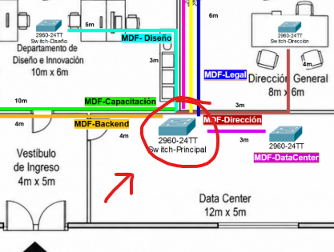

# Manual Técnico , Práctica 1
# Universidad de San Carlos de Guatemala, Facultad de Ingeniería, 
# Escuela de Ciencias y Sistemas
# Laboratorio Redes de computadoras 1
# Nombre: Mayelin Lucía Quevedo Camey , carnet: 2023007771
# Fecha: 22 de Agosto año 2026

## 1. Inventario de equipos (switches, patch panels, racks/gabinetes, tomas de red, y demás equipo propuesto).

**Equipo Activo:**

| Componente | Cantidad | Ubicación |
|---|---|---|
| Switch principal 48 puertos (MDF) | 1 | Data Center |
| Switch departamental 8 puertos | 4 | Recepción, Legal, Dirección General, Data Center |
| Switch departamental 16 puertos | 4 | RRHH, Capacitación, Diseño e Innovación, Backend |

**Patch Panel  -  Rack**
| Componente | Cantidad | Ubicación |
|---|---|---|
| Patch panel 48 puertos | 1 | MDF (Data Center) |
| Rack de piso 24U | 1 | MDF (Data Center) |

**Energía (UPS)**

| Componente | Cantidad | Ubicación |
|---|---|---|
| UPS 3,000 VA | 1 | MDF (Data Center) |

**Tomas de red:**

| Departamento | Tipo de toma | Cantidad de puntos |
|---|---|---|
| Recepción | Unitaria | 4 |
| RRHH | Unitaria | 8 |
| Legal | Unitaria | 4 |
| Capacitación | Unitaria | 10 |
| Diseño e Innovación | Unitaria | 8 |
| Dirección General | Unitaria | 4 |
| Backend | Unitaria | 7 |
| Data Center | Unitaria | 3 |
| **Total** | | **48** |

**opté por tomas unitarias (una por host) en lugar de tomas dobles/triples/N-puertos compartidas, priorizando el aislamiento de fallos: si una toma o su placa física se daña, únicamente se ve afectado el dispositivo conectado a ese punto, sin comprometer la conectividad de los demás hosts que comparten el mismo espacio físico.**

**Cableado:**

| Componente | Cantidad estimada |
|---|---|
| Bobina UTP Cat6 (305m) — troncal + horizontal combinado | 2 |
| Conectores RJ45 Cat6 | 150 (2 por cable horizontal + 2 por troncal) |

*Se combina el cálculo de bobinas para cableado troncal y horizontal (111.1 m + 382.8 m = 493.9 m) en una sola compra, dado que ambos segmentos utilizan el mismo tipo y categoría de cable (UTP Cat6). Esto optimiza la adquisición de materiales frente a comprar bobinas separadas por segmento.*

**Canalización:**

| Componente | Cantidad estimada |
|---|---|
| Escalerilla metálica cerrada | se puede optimizar el uso, para que en un pasillo en común entre dos ó más departamentos se utilice una única escalerrilla, ya que es de gran tamaño , esto es de utilidad para pasar varios cables por ella.  |
| Canaleta PVC superficial | esto va depender directamente a las distancias que se desee para cada hosts |

## 2. Justificación de la ubicación del cuarto de  telecomunicaciones (MDF). 
**Ubicación que se escogió:** Dentro del departamento de Data Center, en donde colinda la sala de Data Center con Diseño e Innovación y Dirección General

  

**nota:**  En los diagramas de planta se utiliza la simbología estandarizada del conmutador modelo `2960-24TT` como representación visual genérica de los nodos de distribución.

**Justificación:**

Al inicio estuve considerando dos opciones principales para la ubicación del MDF: el hall central (por su centralidad en el plano) y el Data Center (por seguridad y condiciones ambientales). opté finalmente por el **Data Center**, priorizando los siguientes criterios técnicos sobre la mínima distancia geométrica:

- **Seguridad física (ANSI/TIA-569):** El hall central es una zona de tránsito continuo (personal, visitas, limpieza), lo que expone el equipo activo a manipulaciones no autorizadas, polvo y golpes accidentales. El Data Center, al ser un espacio cerrado de acceso restringido, protege adecuadamente el switch principal, el patch panel y el UPS.

- **Condiciones ambientales:** El equipo activo requiere un entorno con temperatura y humedad controladas. Un pasillo abierto no permite climatización dedicada, mientras que el Data Center puede acondicionarse para tal fin.

- **Coherencia operativa:** El Data Center ya aloja los 3 servidores principales de la empresa; concentrar ahí también el MDF permite compartir el mismo sistema de seguridad, climatización y respaldo eléctrico (UPS), evitando duplicar infraestructura de soporte en dos ubicaciones distintas.

- **Impacto en la distancia** Al Ubicar el MDF en el Data Center, en lugar del hall central, incrementa el total de cableado troncal de forma marginal (aproximadamente 111metros), lo cual sigue representando una sola bobina de 305 m. Dado que el sobrecosto en cableado es mínimo frente al beneficio de seguridad y control ambiental.

## 3. Justificación de la topología física seleccionada por cada departamento. 
El enunciado de la práctica menciona que cada departamento tiene solo un switch al que se conectan todos sus respectivos hosts, esto me llevó a la conclusión de que la topología más adecuada siempre será topología de estrella, para todos los departamentos

Y para la red completa del edificio: es una topología de árbol / estrella extendida,
con el MDF como raíz y cada switch de departamento como rama.

| Departamento | Hosts | Actividad | TOPOLOGIA | Justificación |
| :--- | :---: | :--- | :---: | :--- |
| Recepción | 3 + 1 servidor | punto de entrada, 1 servidor | **Estrella** | Pocos hosts,el tipo topología de estrella es la opción más económica; suficiente para el tráfico que se trabaja en recepción. |
| Recursos Humanos | 8 | datos de empleados | **Estrella** | El switch aísla su tráfico del resto;  |
| Legal | 4 | documentos confidenciales | **Estrella** | Segmento pequeño pero sensible; topología estrella permite aplicar seguridad a nivel de switch sin sobrecosto |
| Capacitación | 10 | uso temporal/rotativo | **Estrella** | Mayor cantidad de hosts del edificio; estrella escala bien dejando algunos puertos libres |
| Diseño e Innovación | 7 + 1 servidor | incluye QA y un servidor | **Estrella** | Aísla fallos: si un host falla no afecta al servidor ni a los demás puestos |
| Dirección General | 4 | gestión estratégica | **Estrella** | Segmento pequeño; topología estrella es suficiente y fácil de asegurar físicamente |
| Backend | 6 + 1 servidor | servidor de desarrollo | **Estrella** | Prioriza tolerancia a fallos por host individual |
| Data center | 3 servidores | servidores principales | **Estrella** | Con solo 3 nodos, estrella es más que suficiente; los 3 servidores no compiten por ancho de banda entre sí |

## 4. Tabla con el tipo y categoría de cable utilizado por segmento, con su justificación.

Utilicé cable de cobre UTP en la totalidad del edificio (troncal y horizontal). 
sin utilizar fibra óptica, ya que las distancias máximas registradas en el diseño son menores de 30 metros. están muy por debajo del límite de 100 m que soporta el cableado de cobre según el estándar TIA/EIA-568, 
por lo que el uso de fibra significaría un sobrecosto injustificado para las necesidades del edificio.

Categoría de cable: Seleccioné UTP Cat6 de manera uniforme para todos los segmentos (troncal y horizontal), por las siguientes razones:
- Soporta velocidades de hasta 10 Gbps a distancias de hasta ~55 m, y hasta 1 Gbps a los 100 m completos esto es más que suficiente para las distancias del diseño.
- Es compatible con la capacidad Gigabit de los switches seleccionados (switches administrables de 8, 16 y 48 puertos)
- Deja margen de crecimiento a futuro sin necesidad de recablear, en caso de actualizar el equipo.

| Segmento | Tipo de cable | Categoría | Justificación |
| :--- | :--- | :--- | :--- |
| Troncal (MDF ↔ switches de cada uno de los departamentos) | UTP | Cat6 | las Distancias son menores que 30 metros (≤ 30 m), compatible con uplink Gigabit |
| Troncal (MDF ↔ switch de Data Center) | UTP | Cat6 | El Enlace es mucho más corto (3 m) y cabe destacar que es dentro del mismo cuarto |
| Horizontal (switch ↔ hosts) | UTP | Cat6 | Estándar homogéneo, soporta Gigabit por host, escalable a futuro |

## 5. Justificación de cada elemento de equipo activo, con el dimensionamiento de patch panel y switch del edificio. 

cada cálculo se hizo dependiendo de cuántos hosts se conectarán a cada switch, tomando en cuenta que cada switch debe tener un puerto extra  para el uplink, 
que es donde se conectará con el MDF.
Algunos switch quedaban justos con el número necesario,  pero se consideró que para futuro estaría bien que se tomaran switch de muchos más puertos. 

| Departamento | Hosts | + Uplink | Puertos necesarios | Switch elegido | Puertos libres |
| :--- | :---: | :---: | :---: | :---: | :---: |
| Recepción | 4 | +1 | 5 | 8 puertos | 3 |
| RRHH | 8 | +1 | 9 | 16 puertos | 7 |
| Legal | 4 | +1 | 5 | 8 puertos | 3 |
| Capacitación | 10 | +1 | 11 | 16 puertos | 5 |
| Diseño e Innovación | 8 | +1 | 9 | 16 puertos | 7 |
| Dirección General | 4 | +1 | 5 | 8 puertos | 3 |
| Backend | 7 | +1 | 8 | 16 puertos | 8 |
| Data Center | 3 | +1 | 4 | 8 puertos | 4 |

En total, los switches quedaron distribuidos, 
- 4 switch de 8 puertos
- 4 de 16 puertos

## 6. Justificación del medio de transmisión seleccionado para el cableado troncal (MDF - switches de departamento).

El Cable que seleccioné fue el ,  cobre UTP Categoría 6, en todos los enlaces troncales (MDF ↔ switch de cada departamento, incluyendo Data Center).

Los switches de departamento operan a velocidades Gigabit (10/100/1000 Mbps) en sus puertos. UTP Cat6 soporta hasta 1 Gbps en el límite completo de 100 m, y hasta 10 Gbps en distancias de hasta ~55 m — en ambos casos, muy por encima de lo que estos switches pueden generar como tráfico de uplink. No se requiere una categoría superior (Cat6a) ni fibra óptica para alcanzar esta velocidad.

**Distancia:**
El enlace troncal más largo del diseño (MDF → Recepción) mide aproximadamente 25.3 metros(hacia recepción) con holgura incluida, y el resto de los enlaces son aún más cortos. Todos están muy por debajo tanto del límite de 100 m del estándar TIA/EIA-568 para cobre, como del límite de ~55 m donde Cat6 empieza a perder capacidad de 10 Gbps — por lo que la señal viaja sin atenuación significativa en ningún segmento.

**Costo y escalabilidad:**
El cobre UTP Cat6 es significativamente más económico que la fibra óptica.Dado que las distancias del edificio son cortas y no existe justificación técnica de ancho de banda que exija fibra, usarla representaría un sobrecosto sin beneficio real.
 Cat6 además nos deja margen de escalabilidad: si en el futuro se actualiza el equipo activo a switches con capacidad de 10 Gbps, el cableado troncal ya instalado seguiría siendo compatible (dentro del límite de ~55 m), evitando un recableado completo.

## 7. Justificación del tipo de canalización utilizada (escalerilla abierta/cerrada u otro medio). 

**Cableado troncal (MDF ↔ switches de departamento):** Se utiliza **escalerilla metálica tipo charola cerrada**, instalada sobre el cielo raso, recorriendo el Hall Central para distribuir los 8 enlaces troncales hacia ambas filas de departamentos. Se elige tipo cerrada (en lugar de abierta) porque:
- Protege los cables de polvo, golpes accidentales y manipulación no autorizada, dado que el hall es una zona de tránsito constante.
- Al agrupar los 8 troncales en un mismo canal, facilita el orden, la identificación y el mantenimiento futuro (agregar o reemplazar un cable sin afectar a los demás).
- Es una solución económica y de fácil instalación para un edificio de un solo nivel, sin necesidad de canalización subterránea o en muros.

**Cableado horizontal (switch de departamento ↔ hosts):** Se utiliza **canaleta de PVC superficial**, adosada a pared o zócalo dentro de cada oficina, para conectar cada toma de red con el switch de su departamento. Se elige canaleta en lugar de escalerilla porque:
- Los tramos son cortos (dentro de una misma sala) y de bajo volumen de cables por punto, no se justifica el costo de una escalerilla metálica dentro de cada oficina.
- Es más discreta estéticamente para espacios de trabajo (oficinas, sala de capacitación, dirección), a diferencia del hall que es una zona técnica de paso.
- Facilita el acceso para mantenimiento o reubicación de tomas de red sin necesidad de intervenir el cielo raso.

| Segmento | Tipo de canalización | Justificación breve |
|---|---|---|
| Troncal (Hall Central) | Escalerilla metálica cerrada | Protege 8 enlaces agrupados en zona de tránsito |
| Horizontal (dentro de cada oficina) | Canaleta de PVC superficial | Económica, discreta, suficiente para tramos cortos |

## 8. Justificación del tipo de rack o gabinete propuesto para el MDF.

**Rack de piso (floor-standing), de 24U, ubicado dentro del Data Center.**

hice la elección de un gabinete de pared porque el MDF contiene una cantidad considerable de equipo activo y pasivo que debe convivir en el mismo espacio:

| Equipo | Unidades de rack (U) aprox. |
|---|---|
| Patch panel (48 puertos) | 2U |
| Switch principal (48 puertos) | 1U |
| Switch de Data Center | 1U |
| Servidores (3, rack-mount) | 4-6U |
| UPS (rack-mount) | 2-4U |
| **Total ocupado aprox.** | **10-14U** |

Un gabinete de pared típico (6-12U) resultaría insuficiente o quedaría al límite sin espacio para crecimiento. Un **rack de piso de 24U** deja margen suficiente para el equipo actual más una reserva de crecimiento futuro.
Al ubicarlo dentro del Data Center se aprovechan las ventajas de seguridad física y control ambiental.

Adicionalmente, un rack de piso facilita la gestión de cableado vertical (organizadores pasacables) para los 8 enlaces troncales y los cables de los servidores, algo más difícil de lograr en un gabinete de pared de menor profundidad.

## 9. Estimación del consumo eléctrico y capacidad de UPS requerida.

**Consumo estimado del equipo activo (switches de red):**

| Equipo | Consumo típico | Cantidad | Subtotal |
|---|:---:|:---:|:---:|
| Switch principal (48 puertos) | 30 W a 60 W | 1 | 50 W |
| Switches de departamento (8 puertos) | 15 W | 4 | 60 W |
| Switches de departamento (16 puertos) | 20 W | 4 | 80 W |
| **Total consumo de switches** | | | **190 W** |

- **Margen de seguridad (25%):** 190 W × 1.25 = 237.5 W ≈ **240 W**
- **Conversión a VA (Factor de Potencia FP ≈ 0.9):** 240 W ÷ 0.9 ≈ **267 VA**

**UPS para red:** Un UPS de **600 VA / 360 W** cubre con holgura la totalidad de los conmutadores de red.

---

### Servidores Principales (Data Center)

**Consumo estimado de los servidores centrales:**

| Equipo | Consumo típico bajo carga | Cantidad | Subtotal |
|---|:---:|:---:|:---:|
| Servidor rack 1U (uso corporativo) | 350 W | 3 | 1,050 W |
| **Total consumo de servidores** | | | **1,050 W** |

- **Margen de seguridad (25%):** 1,050 W × 1.25 = 1,312.5 W ≈ **1,315 W**
- **Conversión a VA (Factor de Potencia FP ≈ 0.9):** 1,315 W ÷ 0.9 ≈ **1,461 VA**

**UPS para servidores:** Un UPS de topología On-Line de **2,200 VA / 1,980 W** brinda la autonomía y protección adecuada para la carga de los 3 servidores.

---

### Dimensionamiento del UPS para el Rack del MDF (Data Center)

| Carga respaldada | Capacidad mínima calculada | Solución seleccionada |
|---|:---:|:---:|
| Switches de red | 267 VA / 240 W | 600 VA / 360 W |
| Servidores principales | 1,461 VA / 1,315 W | 2,200 VA / 1,980 W |
| **Carga total consolidada (Switch Core + 3 Servidores + Margen)** | **1,728 VA / 1,555 W** | **UPS On-Line 3,000 VA / 2,700 W (Rack 2U/3U)** |

*Justificación de la solución elegida:* Se opta por un **UPS centralizado de 3,000 VA / 2,700 W** instalado en el rack de 24U del Data Center, el cual centraliza el respaldo de los servidores principales y el switch Core, garantizando una autonomía de 15 a 20 minutos ante cortes de fluido eléctrico con un margen de escalabilidad superior al 40%.

## 10. Tabla indicando straight-through/cros

Esto depende si conectamos dispositivos del mismo tipo o de tipo distinto.

- Dispositivos distintos (PC ↔ switch, switch ↔ patch panel) → cable straight-through (mismo estándar en ambos extremos: T568B-T568B, o T568A-T568A).
- Dispositivos del mismo tipo (switch ↔ switch) → cable crossover (un extremo T568A, el otro T568B).

| Enlace | Dispositivos que conecta | Tipo de cable | Justificación |
| :--- | :--- | :--- | :--- |
| Host → toma de red / patch panel (cableado horizontal) | PC/laptop/servidor ↔ patch panel | Straight-through | Dispositivos de tipo distinto (host vs. equipo pasivo de red); mismo estándar en ambos extremos, como exige el enunciado |
| Patch panel → switch de departamento | Patch panel ↔ switch | Straight-through | El patch panel solo extiende la señal del host; sigue siendo lógicamente host ↔ switch |
| Switch de departamento → switch principal (MDF) | Switch ↔ switch | Crossover | Dispositivos del mismo tipo (dos switches); requiere invertir pares de transmisión/recepción |

## 11. Disposición de pines documentada (mínimo un  straight-through y un crossover). 

**Ejemplo 1 — Cable Straight-through** (ej. `Recepcion-PR01`, host → patch panel)

Se pinchan ambos extremos bajo el mismo estándar T568B:

| Pin | Extremo A (toma de red) | Extremo B (patch panel) |
|---|---|---|
| 1 | Blanco/Naranja | Blanco/Naranja |
| 2 | Naranja | Naranja |
| 3 | Blanco/Verde | Blanco/Verde |
| 4 | Azul | Azul |
| 5 | Blanco/Azul | Blanco/Azul |
| 6 | Verde | Verde |
| 7 | Blanco/Café | Blanco/Café |
| 8 | Café | Café |

*Los 8 pines quedan en el mismo orden en ambos extremos — por eso se llama "straight" (derecho), no hay ningún cruce de pares.*

**Ejemplo 2 — Cable Crossover** (ej. `MDF-Legal`, switch ↔ switch)

Un extremo se pincha en T568B y el otro en T568A, para invertir los pares de transmisión/recepción:

| Pin | Extremo A (switch MDF, T568B) | Extremo B (switch Legal, T568A) |
|---|---|---|
| 1 | Blanco/Naranja | Blanco/Verde |
| 2 | Naranja | Verde |
| 3 | Blanco/Verde | Blanco/Naranja |
| 4 | Azul | Azul |
| 5 | Blanco/Azul | Blanco/Azul |
| 6 | Verde | Naranja |
| 7 | Blanco/Café | Blanco/Café |
| 8 | Café | Café |

## 12. Tabla de etiquetado de cables. 

Formato definido en el enunciado:
- **Cableado horizontal:** `[Área/Departamento]-[Número de Punto de Red]` (ej. `Recepcion-PR01`)
- **Cableado troncal:** `MDF-[Área/Departamento]` (ej. `MDF-Legal`)

**Cableado Troncal (8 enlaces):**

| Etiqueta | Origen | Destino |
|---|---|---|
| MDF-Recepcion | Switch principal (MDF) | Switch Recepción |
| MDF-RRHH | Switch principal (MDF) | Switch RRHH |
| MDF-Legal | Switch principal (MDF) | Switch Legal |
| MDF-Capacitacion | Switch principal (MDF) | Switch Capacitación |
| MDF-Diseno | Switch principal (MDF) | Switch Diseño e Innovación |
| MDF-Direccion | Switch principal (MDF) | Switch Dirección General |
| MDF-Backend | Switch principal (MDF) | Switch Backend |
| MDF-DataCenter | Switch principal (MDF) | Switch Data Center |

**Cableado Horizontal (48 puntos de red):**

| Departamento | Rango de etiquetas | Cantidad de puntos |
|---|---|---|
| Recepción | Recepcion-PR01 a Recepcion-PR04 | 4 |
| RRHH | RRHH-PR01 a RRHH-PR08 | 8 |
| Legal | Legal-PR01 a Legal-PR04 | 4 |
| Capacitación | Capacitacion-PR01 a Capacitacion-PR10 | 10 |
| Diseño e Innovación | Diseno-PR01 a Diseno-PR08 | 8 |
| Dirección General | Direccion-PR01 a Direccion-PR04 | 4 |
| Backend | Backend-PR01 a Backend-PR07 | 7 |
| Data Center | DataCenter-PR01 a DataCenter-PR03 | 3 |
| **Total** | | **48** |

## 13. Comparación entre el etiquetado usado y el estándar TIA/EIA-606, con al menos dos diferencias concretas.
El estándar **TIA/EIA-606** (Administración de Infraestructura de Telecomunicaciones) define un sistema formal y completo para documentar y administrar una red, pensado para instalaciones grandes y de largo plazo a diferencia del esquema de etiquetado usado en esta práctica (`Departamento-PR0X` y `MDF-Departamento`).

**Diferencia 1 — Identificadores únicos y persistentes:**
El estándar 606 exige que cada elemento (cable, puerto, espacio, equipo) tenga un identificador único registrado en una base de datos central de administración, que se mantiene actualizada durante toda la vida útil de la infraestructura. En esta práctica, el etiquetado (`Recepcion-PR01`) es descriptivo y legible, pero no está vinculado a ningún registro/base de datos formal — es solo una referencia visual en el diagrama y la tabla del manual.

**Diferencia 2 — Codificación por colores:**
El estándar 606 recomienda codificación por colores según el tipo de circuito (por ejemplo, un color para backbone/troncal, otro para horizontal, otro para enlaces entre edificios). En esta práctica solo se usó diferenciación visual básica (grosor o color de línea en el diagrama), sin un código de colores formal y estandarizado a nivel de todo el proyecto.

**Diferencia 3 — Registro de espacios y rutas:**
El estándar exige documentación formal de cada espacio de telecomunicaciones (MDF, IDF) y cada ruta de canalización, incluyendo su capacidad, ocupación y planos "as-built" actualizados. Aquí se documentó la ubicación y ruta de forma descriptiva en el manual, pero sin el nivel de formalidad (registros históricos, planos certificados) que exige el estándar completo.

**¿Por qué en un entorno real se optaría por el estándar completo?**
En un Data Center o cuarto de telecomunicaciones real, la infraestructura crece y cambia constantemente (nuevos equipos, mudanzas, fallas). Sin un sistema de identificación único y una base de datos de administración, localizar un cable específico entre cientos de enlaces, o dar mantenimiento sin duplicar trabajo, se vuelve muy difícil y propenso a errores costosos. El estándar completo permite trazabilidad, auditoría y continuidad del conocimiento incluso si cambia el personal técnico a cargo — algo que un esquema simplificado como el de esta práctica no puede garantizar a esa escala.

## 14. Descripción del flujo de conexión end-to-end. 

Se documenta el recorrido completo de un dispositivo final, usando como ejemplo una PC de escritorio del departamento de Legal:

1. **Host (PC de escritorio, Legal):** Genera tráfico de red y lo envía a través de su tarjeta de red (NIC).
2. **Toma de red (jack de pared, `Legal-PR01`):** Punto de conexión física donde el usuario conecta su patch cord hacia la pared.
3. **Cableado horizontal (UTP Cat6, straight-through, T568B-T568B):** Conduce la señal mediante la canaleta perimetral de PVC hacia el switch de acceso ubicado dentro del departamento de Legal.
4. **Switch de departamento (Legal, 8 puertos):** Recibe la trama del host y la conmuta localmente, o la reenvía por su puerto de enlace troncal (Uplink) si el destino está fuera del departamento.
5. **Cableado troncal (`MDF-Legal`, UTP Cat6, crossover T568B-T568A):** Transporta el tráfico desde el switch de Legal a través de la escalerilla metálica del Hall Central hasta el Data Center.
6. **Patch panel (48 puertos, MDF):** Punto de remate físico ordenado en el rack del Data Center que entrega el enlace troncal al switch central.
7. **Switch principal (MDF, 48 puertos):** Núcleo de la red que conmuta los paquetes hacia el servidor de destino o hacia el enlace de salida general.

De esta manera, cualquier host del edificio puede comunicarse con cualquier otro siguiendo esta misma ruta lógica: **Host → Toma de red → Cableado horizontal → Patch panel → Switch departamental → Cableado troncal → Switch principal (MDF)**, y el camino inverso para la respuesta.

# 15. Presupuesto estimado del equipo y materiales utilizados. 

| Categoría | Componente | Cantidad | Precio unitario aprox. (Q) | Subtotal (Q) |
|---|---|:---:|:---:|:---:|
| Equipo activo | Switch principal 48 puertos (Administrable) | 1 | 4,800 | 4,800 |
| Equipo activo | Switch departamental 8 puertos | 4 | 450 | 1,800 |
| Equipo activo | Switch departamental 16 puertos | 4 | 850 | 3,400 |
| Equipo pasivo | Patch panel 48 puertos | 1 | 600 | 600 |
| Infraestructura | Rack de piso 24U | 1 | 8,500 | 8,500 |
| Energía | UPS On-Line 3,000 VA / 2,700W | 1 | 7,050 | 7,050 |
| Cableado | Bobinas UTP Cat6 (305m) — troncal + horizontal | 2 | 950 | 1,900 |
| Terminaciones | Conectores RJ45 Cat6 (paquete de 50) | 3 | 120 | 360 |
| Terminaciones | Tomas de red (jack + placa) | 48 | 35 | 1,680 |
| Canalización | Escalerilla metálica rejilla (tramo de 3m) | 10 | 370 | 3,700 |
| Canalización | Canaleta PVC superficial (tramo de 2m) | 40 | 45 | 1,800 |
| **TOTAL ESTIMADO** | | | | **Q35,590** |

