# Informe de Desarrollo 
# Práctica 2: Red de la Ciudad Comercial Cayalá

- **Nombre:** Mayelin Lucía Quevedo Camey
- **Carnet:** 202307771  
- **Curso:** Redes de Computadoras 1 · 2S2026

##  Introducción
Esta práctica consistió en diseñar e implementar en Cisco Packet Tracer la red de cinco zonas de Ciudad Cayalá, segmentada con VLANs y conectada mediante switches y enlaces troncales. Se configuraron VLANs, VTP, Rapid PVST+ y EtherChannel con PAgP, además de enrutamiento entre VLANs en un switch multicapa. El objetivo fue lograr conectividad entre todas las zonas y comprobar la redundancia de la red con pruebas de ping y simulación.

##  Resumen de la implementación
- 5 zonas reales de Cayalá: plaza comercial, administración y seguridad, residencial, corporativa y cines.
- 10 switches: 3 Cisco 3560 y 7 Cisco 2960.
- 15 PCs de prueba, 3 por VLAN.
- VLANs 11, 21, 31, 41 y 51, además de VLAN nativa 99 y Blackhole 999.
- VTP dominio 202307771, Rapid PVST+, y EtherChannel con **PAgP** por ser el carnet impar.
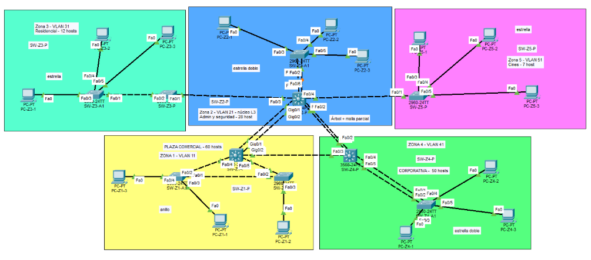

##  Desarrollo paso a paso

###  1. Diseño y cableado
**1.1 Elección de las zonas.**
Seleccioné cinco zonas del complejo Cayalá que cubren los distintos tipos de actividad que describe el enunciado:

- plaza comercial, 
- administración y seguridad, 
- residencial, 
- corporativa y 
- cines. 

Para cada una analicé su rol, el tipo de usuarios, el volumen de tráfico según la cantidad de hosts y el impacto que tendría perder su conectividad. Con base en eso asigné la cantidad de hosts que pide la tabla del enunciado: las zonas con más actividad y más usuarios (plaza comercial con 60 hosts y corporativa con 50) quedaron como las de criticidad alta, la de administración y seguridad (28 hosts) como la más crítica por ser el centro de control del complejo, y la residencial (12 hosts) y los cines (7 hosts) como las de menor criticidad.

**1.2 Diseño de la topología híbrida.**

 En lugar de aplicar el mismo esquema a todas las zonas, elegí el tipo de conexión según el rol de cada una:

- **Núcleo:** SW-Z2-P, SW-Z1-P y SW-Z4-P forman una malla parcial (triángulo) para que las zonas de mayor tráfico tengan un camino alterno si falla un enlace. Desde SW-Z2-P salen ramas en forma de árbol hacia las zonas 3 y 5.
- **Zona 1 (anillo):** tres switches conectados en círculo dan redundancia a la zona con más hosts sin agregar equipos adicionales. Rapid PVST+ bloquea un enlace para evitar bucles y lo activa si otro falla.
- **Zonas 2 y 4 (estrella con enlace doble):** al ser zonas críticas o de alto tráfico, el switch principal se conecta al de acceso con dos enlaces físicos, de modo que la falla de uno no interrumpe la operación.
- **Zonas 3 y 5 (estrella simple):** por su bajo tráfico y menor criticidad, un solo enlace es suficiente, y así se evita un costo y una complejidad que no aportan beneficio.

usé EtherChannel con PAgP en los enlaces del núcleo hacia las zonas 1 y 4, que son las de mayor número de hosts, para sumar ancho de banda y tolerar la caída de un enlace sin reconvergencia de STP. Un enrutamiento entre VLANs en el switch multicapa SW-Z2-P permite la comunicación entre zonas.

###  2. Configuración de PCs 
- **configurando ip static para las 5 zonas diferentes:** (evidencia tomada solo para 1 pc por zona)
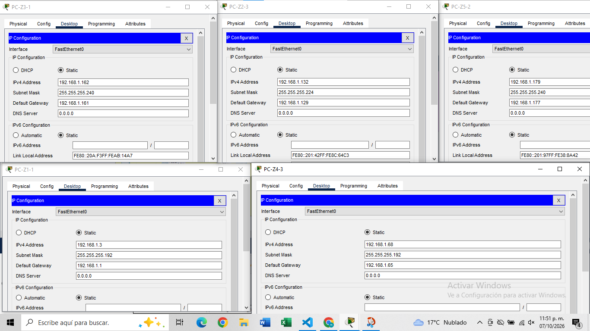

###  3. VTP y VLANs
- vtp servidor

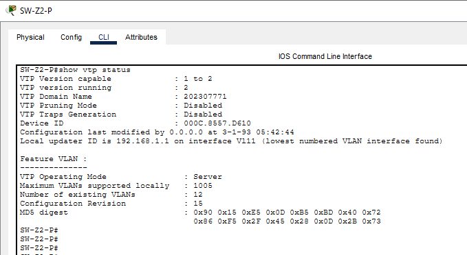

- vtp cliente

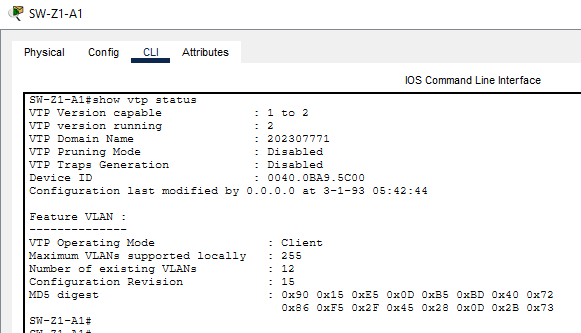

- vlan desde servidor

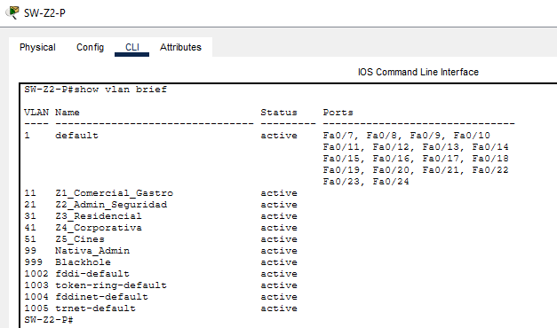

- vlan desde cliente

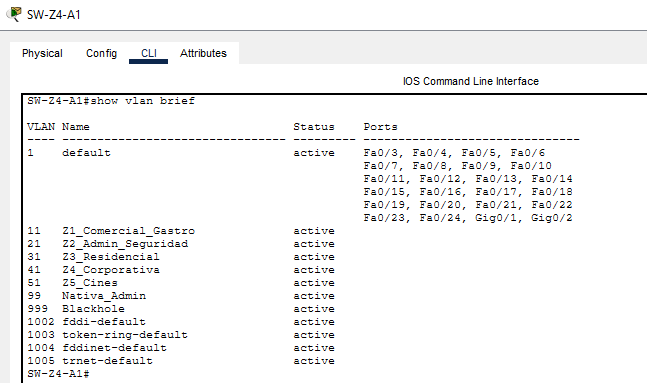

###  4. Troncales y EtherChannel
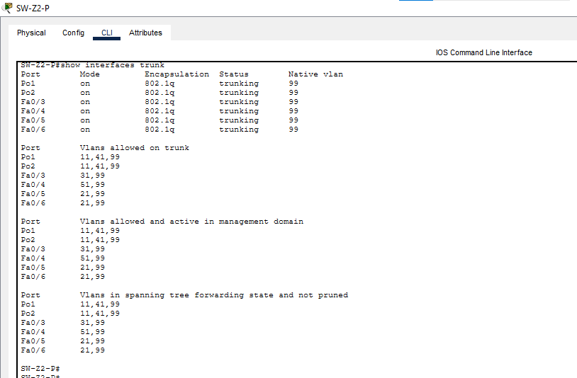
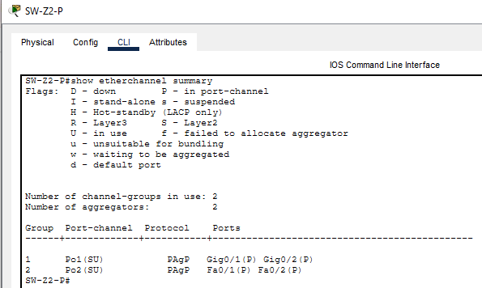

- EtherChannel

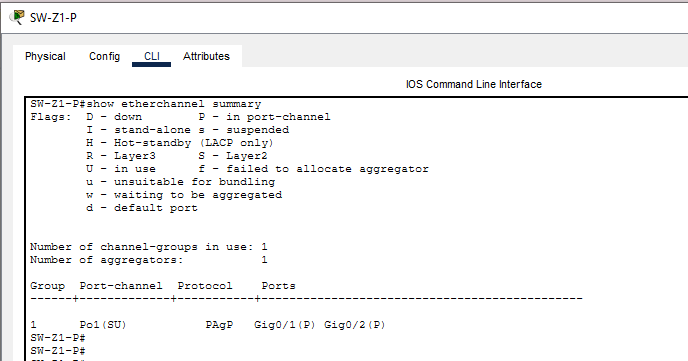

###  5. Rapid PVST+ y root bridges
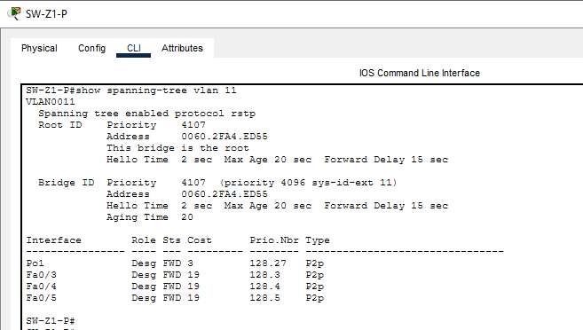
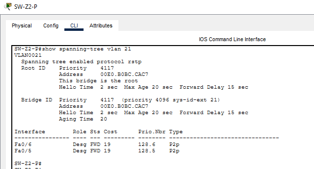
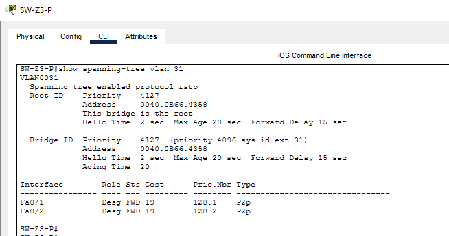
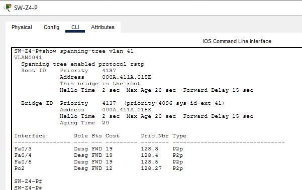
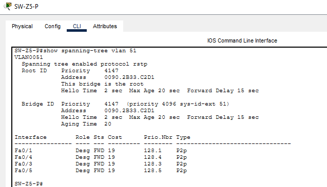

   > **Nota:** se configuró `priority 4096` y Rapid PVST+ le suma el número de VLAN. Por eso `show spanning-tree` muestra 4107 para la VLAN 11, 4117 para la 21, 4127 para la 31, 4137 para la 41 y 4147 para la 51.

### 6.  Enrutamiento inter-VLAN
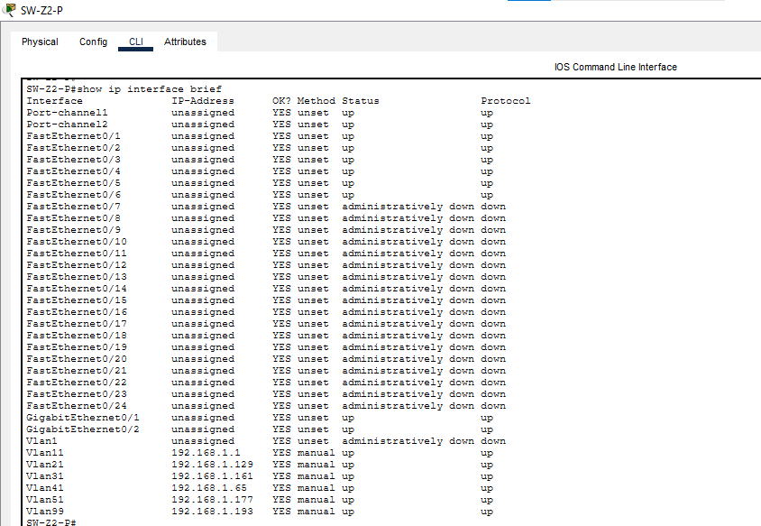
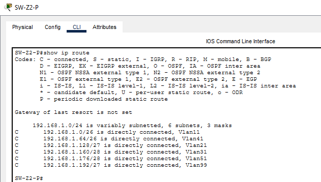

###  7. Puertos sin uso
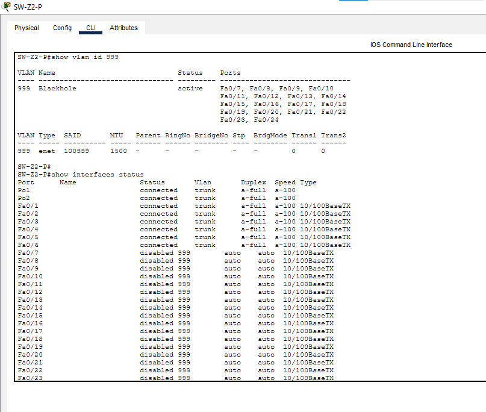

##  Pruebas realizadas
- **hice pruebas de ping desde todas las zonas, etherchannel, icmp y arp**
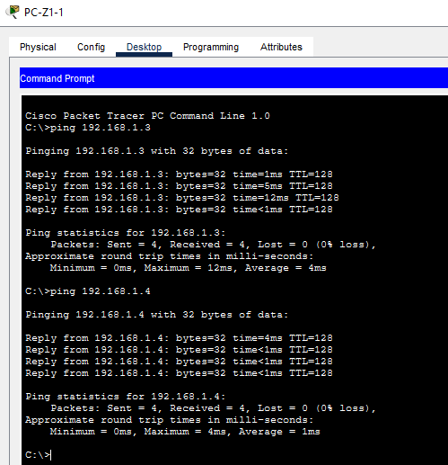
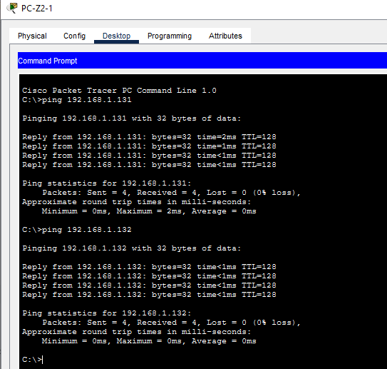
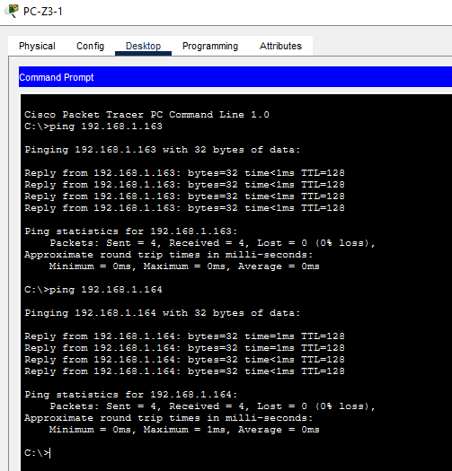
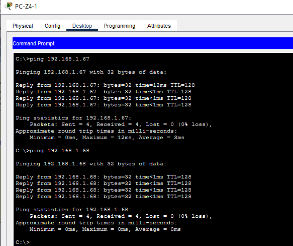
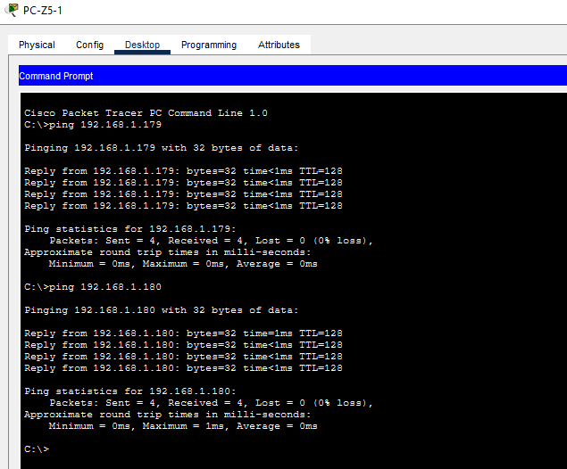
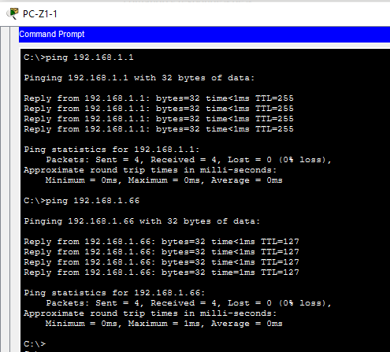
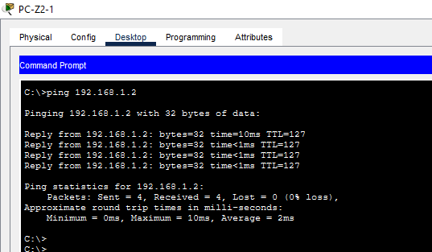
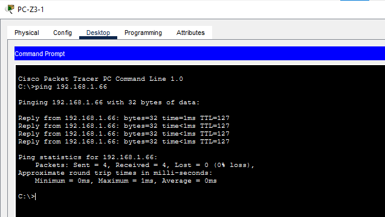
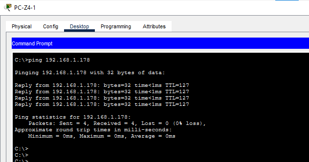
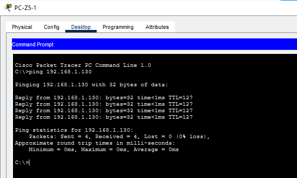
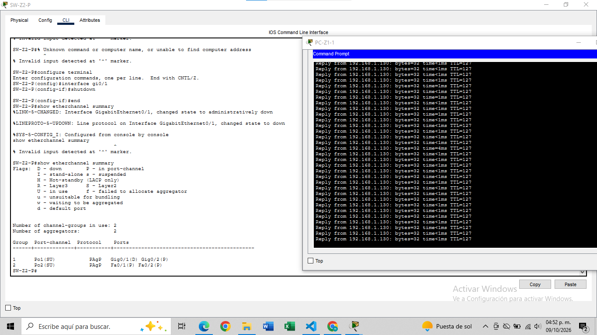
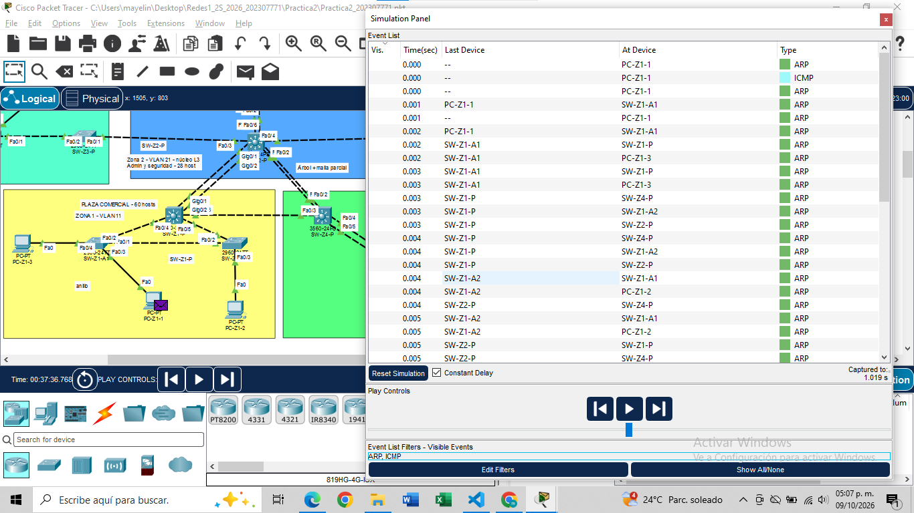
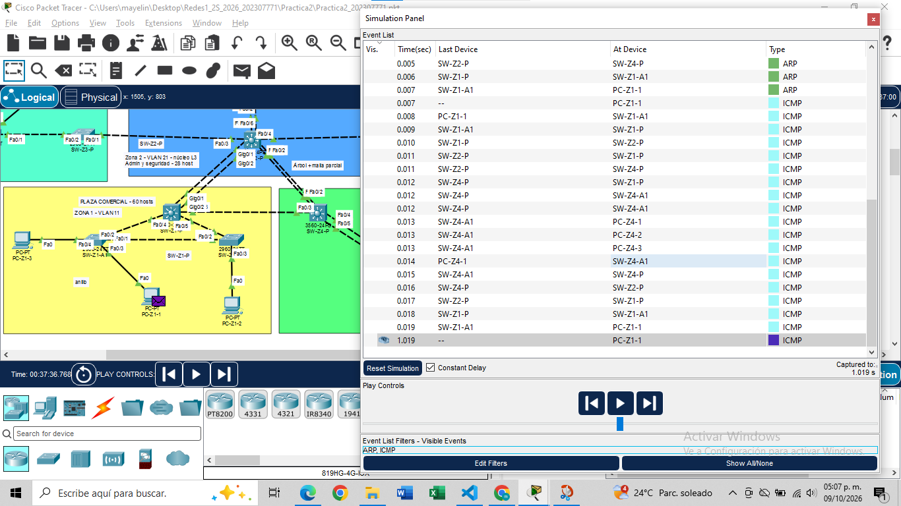

**Análisis ARP/ICMP:** Se realizó un ping desde PC-Z1-1 (VLAN 11) hacia PC-Z4-1 (VLAN 41) en modo Simulation, filtrando solo los eventos ARP e ICMP.

1. **ARP (0.000 a 0.007 s).** Como el destino 192.168.1.66 está en otra red, PC-Z1-1 necesita la dirección MAC de su gateway (192.168.1.1, la interfaz VLAN 11 de SW-Z2-P). Por eso envió una solicitud ARP por broadcast. El broadcast recorrió la VLAN 11: llegó a PC-Z1-2 y PC-Z1-3, y subió por las troncales hasta SW-Z2-P y SW-Z4-P, pero no se entregó a ningún PC de otra VLAN. SW-Z2-P respondió y la respuesta llegó a PC-Z1-1 en 0.007 s.
2. **ICMP (0.007 a 0.019 s).** Con la MAC del gateway ya conocida, PC-Z1-1 envió el echo request, que pasó por SW-Z1-A1 y SW-Z1-P hasta SW-Z2-P. Este switch multicapa enrutó el paquete hacia la VLAN 41, que bajó por SW-Z4-P y SW-Z4-A1 hasta PC-Z4-1 (0.013 s). El echo reply regresó por el mismo camino y llegó a PC-Z1-1 en 0.019 s.
3. **Siguiente paquete (1.019 s).** Se observa el siguiente ICMP del ping, que sale un segundo después. Esto explica por qué en la consola el primer paquete de cada ping hacia otra VLAN suele dar `Request timed out`: el tiempo que toma resolver el ARP.

**Conclusiones de la simulación:** el broadcast del ARP quedó contenido en la VLAN 11, lo que demuestra que cada VLAN es un dominio de broadcast independiente, y todo el tráfico entre zonas pasa por SW-Z2-P, que es el punto de enrutamiento.

## Problemas encontrados y soluciones
 
| # | Problema | Causa | Solución |
|---|---|---|---|
| 1 | `%EC-5-L3DONTBNDL2: suspended: PAGP currently not enabled on the remote port` | Se configuró un extremo del EtherChannel antes que el otro | Se configuró el otro extremo y los canales pasaron a `SU` |
| 2 | `%CDP-4-NATIVE_VLAN_MISMATCH` en varios puertos | El vecino aún tenía la VLAN nativa por defecto (1) y el otro ya usaba la 99 | Se terminó la FASE 1 en los 10 switches |
| 3 | El primer ping hacia otra VLAN daba `Request timed out` | El PC resolvía por ARP la dirección del gateway | Es el comportamiento normal; los siguientes paquetes respondieron |
| 4 | Los íconos y las etiquetas de puertos se encimaban en la topología | Zonas muy juntas y cables cruzados | Se reorganizaron las zonas y se separaron los switches |

##  Conclusiones
La segmentación con VLANs y la elección de una topología distinta según la criticidad de cada zona permitió dar más redundancia donde una falla tiene mayor impacto, sin gastar recursos en las zonas pequeñas. VTP simplificó la administración, ya que las VLANs se crearon una sola vez y se propagaron a todos los switches, mientras que Rapid PVST+ evitó los bucles y el EtherChannel mantuvo la conectividad al caer un enlace. 

## 8. Anexos
- Scripts CLI:  `Código_Fuente.md`.
- Archivo de Packet Tracer: `Practica2_202307771.pkt`.