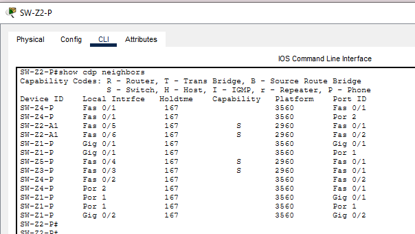

# Manual Técnico — Práctica 2: Red de la Ciudad Comercial Cayalá

# **Curso:** Redes de Computadoras 1 , 2S2026
# **Universidad de San Carlos de Guatemala — Facultad de Ingeniería, Ingeniería en Ciencias y Sistemas**
# **Nombre:** Mayelin Lucía Quevedo Camey
# **Carnet:** 202307771 

##  Parámetros 

| Parámetro | Valor |
|---|---|
| Último dígito (X) | 1 |
| VLANs de zona | 11, 21, 31, 41, 51 |
| Dominio VTP | 202307771 |
| Contraseña VTP | `Cayala2026` |
| Protocolo EtherChannel | **PAgP** (último dígito impar) |
| VLAN nativa | 99 |
| VLAN Blackhole | 999 |

---

##  Análisis de las zonas

| Zona | Nombre | Rol operativo | Usuarios | Hosts | Tráfico estimado | Criticidad |
|---|---|---|---|---|---|---|
| 1 | Plaza comercial | Locales, restaurantes y puntos de venta | Visitantes y comerciantes | 60 | Alto (POS, Wi-Fi, cámaras) | **Alta** |
| 2 | Administración y seguridad | Control central, monitoreo y servicios de red | Personal administrativo y de seguridad | 28 | Medio, con servicios críticos | **Crítica** |
| 3 | Residencial | Conserjería y servicios de residentes | Residentes y conserjes | 12 | Bajo | Media-baja |
| 4 | Corporativa | Torres de oficinas | Empleados de empresas | 50 | Alto y constante | **Alta** |
| 5 | Cines | Taquilla y administración del cine | Personal del cine | 7 | Bajo | Baja-media |

**Justificación de criticidad**
- **Zona 2:** si pierde conectividad, se cae la administración y la seguridad de todo el complejo. Además aloja el switch multicapa que enruta entre VLANs.
- **Zonas 1 y 4:** concentran la mayor cantidad de hosts y actividad económica, así que necesitan más ancho de banda y redundancia.
- **Zonas 3 y 5:** su caída afecta a pocos usuarios y puede tolerar un solo enlace.

---

##  Tabla de VLANs y direccionamiento

Bloque base: `192.168.1.0/24`, dividido con VLSM de mayor a menor.

| Zona | VLAN | Nombre | Hosts req. | Red | Máscara | Gateway (SVI) | Rango útil | Capacidad |
|---|---|---|---|---|---|---|---|---|
| 1 | 11 | Z1_Comercial_Gastro | 60 | 192.168.1.0/26 | 255.255.255.192 | 192.168.1.1 | .1–.62 | 62 |
| 4 | 41 | Z4_Corporativa | 50 | 192.168.1.64/26 | 255.255.255.192 | 192.168.1.65 | .65–.126 | 62 |
| 2 | 21 | Z2_Admin_Seguridad | 28 | 192.168.1.128/27 | 255.255.255.224 | 192.168.1.129 | .129–.158 | 30 |
| 3 | 31 | Z3_Residencial | 12 | 192.168.1.160/28 | 255.255.255.240 | 192.168.1.161 | .161–.174 | 14 |
| 5 | 51 | Z5_Cines | 7 | 192.168.1.176/28 | 255.255.255.240 | 192.168.1.177 | .177–.190 | 14 |
| — | 99 | Nativa_Admin (gestión) | 10 switches | 192.168.1.192/27 | 255.255.255.224 | 192.168.1.193 | .193–.222 | 30 |
| — | 999 | Blackhole | — | sin IP | — | — | puertos sin uso | — |

Total de hosts requeridos: 60 + 28 + 12 + 50 + 7 = **157**.  en la simulación en packet tracer se colocaron **3 dispositivos funcionales por VLAN** (15 PCs).

###  IPs de gestión (VLAN 99)

| Switch | IP |
|---|---|
| SW-Z2-P | 192.168.1.193 |
| SW-Z1-P | 192.168.1.194 |
| SW-Z4-P | 192.168.1.195 |
| SW-Z3-P | 192.168.1.196 |
| SW-Z5-P | 192.168.1.197 |
| SW-Z1-A1 | 192.168.1.198 |
| SW-Z1-A2 | 192.168.1.199 |
| SW-Z2-A1 | 192.168.1.200 |
| SW-Z3-A1 | 192.168.1.201 |
| SW-Z4-A1 | 192.168.1.202 |

###  Hosts de prueba

| Host | Switch | puerto | IP | Máscara | Gateway |
|---|---|---|---|---|---|
| PC-Z1-1 | SW-Z1-A1 | Fa0/3 | 192.168.1.2 | 255.255.255.192 | 192.168.1.1 |
| PC-Z1-2 | SW-Z1-A2 | Fa0/3 | 192.168.1.3 | 255.255.255.192 | 192.168.1.1 |
| PC-Z1-3 | SW-Z1-A1 | Fa0/4 | 192.168.1.4 | 255.255.255.192 | 192.168.1.1 |
| PC-Z2-1 | SW-Z2-A1 | Fa0/3 | 192.168.1.130 | 255.255.255.224 | 192.168.1.129 |
| PC-Z2-2 | SW-Z2-A1 | Fa0/4 | 192.168.1.131 | 255.255.255.224 | 192.168.1.129 |
| PC-Z2-3 | SW-Z2-A1 | Fa0/5 | 192.168.1.132 | 255.255.255.224 | 192.168.1.129 |
| PC-Z3-1 | SW-Z3-A1 | Fa0/3 | 192.168.1.162 | 255.255.255.240 | 192.168.1.161 |
| PC-Z3-2 | SW-Z3-A1 | Fa0/4 | 192.168.1.163 | 255.255.255.240 | 192.168.1.161 |
| PC-Z3-3 | SW-Z3-A1 | Fa0/5 | 192.168.1.164 | 255.255.255.240 | 192.168.1.161 |
| PC-Z4-1 | SW-Z4-A1 | Fa0/3 | 192.168.1.66 | 255.255.255.192 | 192.168.1.65 |
| PC-Z4-2 | SW-Z4-A1 | Fa0/4 | 192.168.1.67 | 255.255.255.192 | 192.168.1.65 |
| PC-Z4-3 | SW-Z4-A1 | Fa0/5 | 192.168.1.68 | 255.255.255.192 | 192.168.1.65 |
| PC-Z5-1 | SW-Z5-P | Fa0/3 | 192.168.1.178 | 255.255.255.240 | 192.168.1.177 |
| PC-Z5-2 | SW-Z5-P | Fa0/4 | 192.168.1.179 | 255.255.255.240 | 192.168.1.177 |
| PC-Z5-3 | SW-Z5-P | Fa0/5 | 192.168.1.180 | 255.255.255.240 | 192.168.1.177 |

- **Configuración IP de un PC por zona**

---

##  Topología

###  Topología en Packet Tracer

Topología completa: 

###  Resumen de dispositivos

| Zona | Switches | PCs |
|---|---|---|
| 1 | 3 (SW-Z1-P 3560, SW-Z1-A1 y A2 2960) | 3 |
| 2 | 2 (SW-Z2-P 3560, SW-Z2-A1 2960) | 3 |
| 3 | 2 (SW-Z3-P y SW-Z3-A1, 2960) | 3 |
| 4 | 2 (SW-Z4-P 3560, SW-Z4-A1 2960) | 3 |
| 5 | 1 (SW-Z5-P 2960) | 3 |
| **Total** | **10** | **15** |

###  Topología híbrida: clasificación por zona

combiné **cuatro** (anillo, estrella, árbol y malla parcial), elegidos según el rol, la criticidad y el volumen de tráfico de cada zona. Para clasificar se analiza solo la conexión entre **switches** 

| Parte de la red | Topología | ¿Ciclo? | ¿Cable doble? | Criticidad |
|---|---|---|---|---|
| Núcleo (Z2, Z1, Z4, Z3, Z5) | Árbol jerárquico + malla parcial | Sí (triángulo Z2–Z1–Z4) | Sí (EtherChannel) | Crítica |
| Zona 1, plaza comercial | **Anillo** de 3 switches | Sí | No | Alta |
| Zona 2, administración y seguridad | **Estrella con enlace doble** | Sí (el par redundante) | Sí | Crítica |
| Zona 3, residencial | **Estrella simple** | No | No | Media-baja |
| Zona 4, corporativa | **Estrella con enlace doble** | Sí (el par redundante) | Sí | Alta |
| Zona 5, cines | **Estrella simple** | No | No | Baja-media |

#### Núcleo: árbol jerárquico con malla parcial
SW-Z2-P es la raíz y de él salen ramas hacia las Zonas 3 y 5 (estructura de árbol). Además, SW-Z2-P, SW-Z1-P y SW-Z4-P forman un triángulo con enlaces entre sí (malla parcial), de modo que las dos zonas de mayor tráfico tienen un camino alterno si falla un enlace del núcleo. Los enlaces Z2–Z1 y Z2–Z4 son EtherChannel (PAgP) de dos enlaces físicos.

#### Zona 1, plaza comercial: anillo
SW-Z1-P, SW-Z1-A1 y SW-Z1-A2 forman un circuito cerrado: SW-Z1-P → SW-Z1-A1 → SW-Z1-A2 → SW-Z1-P. Cada switch se conecta con exactamente dos vecinos. Si se corta un enlace del anillo, el tráfico llega por el lado contrario. Rapid PVST+ bloquea un puerto del anillo para evitar bucles y lo activa solo si hace falta. Se eligió porque es la zona con más hosts (60) y criticidad alta, y el anillo da redundancia sin agregar más switches.

#### Zona 2, administración y seguridad: estrella con enlace doble
SW-Z2-A1 es el centro de la estrella de los PCs y se conecta al principal SW-Z2-P con **dos enlaces físicos** (Fa0/5-6 a Fa0/1-2). Uno queda activo y el otro en respaldo por STP. Cumple la condición de alta disponibilidad (mínimo 2 enlaces) en la zona más crítica del complejo.

#### Zona 3, residencial: estrella simple
Un solo enlace hacia el núcleo (SW-Z2-P Fa0/3 → SW-Z3-P Fa0/1) y un solo enlace entre SW-Z3-P y SW-Z3-A1, de donde cuelgan los PCs. Es la zona de menor tráfico y criticidad media-baja, por lo que un enlace único es suficiente y evita costo y complejidad innecesarios. El switch de acceso actúa como centro de la estrella de los PCs.

#### Zona 4, corporativa: estrella con enlace doble
SW-Z4-P se conecta con SW-Z4-A1 por **dos enlaces físicos** (Fa0/4-5 a Fa0/1-2), con uno activo y otro de respaldo por STP. Hacia el núcleo usa el EtherChannel Po2 y un enlace cruzado hacia la Zona 1, por lo que tiene varios caminos. Se justifica por sus 50 estaciones y el tráfico constante de oficina.

#### Zona 5, cines: estrella simple
SW-Z5-P es el centro: los 3 PCs se conectan directamente a él y un único enlace sube al núcleo (SW-Z2-P Fa0/4 → SW-Z5-P Fa0/1). Es la zona más pequeña (7 hosts) y de menor criticidad, por lo que no requiere redundancia.

---

##  Enlaces físicos y justificación

Estándar TIA/EIA-568B. **Crossover** entre switches y **straight-through** entre PC y switch.

   **Medios de enlace:** todos los enlaces son de cobre UTP. Se usó Gigabit Ethernet en el EtherChannel Po1 (Z2–Z1) y Fast Ethernet en el resto. Cable crossover entre switches y straight-through hacia los PCs.

| # | Origen | Destino | Cable | Tipo | VLANs permitidas | Justificación |
|---|---|---|---|---|---|---|
| 1-2 | SW-Z2-P Gi0/1-2 | SW-Z1-P Gi0/1-2 | Crossover | **Po1 (PAgP)** | 11,41,99 | Zona de mayor tráfico (60 hosts) |
| 3-4 | SW-Z2-P Fa0/1-2 | SW-Z4-P Fa0/1-2 | Crossover | **Po2 (PAgP)** | 11,41,99 | Zona corporativa (50 hosts) |
| 5 | SW-Z1-P Fa0/3 | SW-Z4-P Fa0/3 | Crossover | Troncal | 11,41,99 | Cierra la malla; ruta alterna |
| 6 | SW-Z2-P Fa0/3 | SW-Z3-P Fa0/1 | Crossover | Troncal | 31,99 | Zona de baja criticidad |
| 7 | SW-Z2-P Fa0/4 | SW-Z5-P Fa0/1 | Crossover | Troncal | 51,99 | Zona pequeña y secundaria |
| 8-9 | SW-Z2-P Fa0/5-6 | SW-Z2-A1 Fa0/1-2 | Crossover | Troncal doble (STP) | 21,99 | Zona crítica con 2 enlaces |
| 10 | SW-Z1-P Fa0/4 | SW-Z1-A1 Fa0/1 | Crossover | Troncal | 11,99 | Anillo Z1 |
| 11 | SW-Z1-A1 Fa0/2 | SW-Z1-A2 Fa0/1 | Crossover | Troncal | 11,99 | Anillo Z1 |
| 12 | SW-Z1-A2 Fa0/2 | SW-Z1-P Fa0/5 | Crossover | Troncal | 11,99 | Anillo Z1 |
| 13 | SW-Z3-P Fa0/2 | SW-Z3-A1 Fa0/1 | Crossover | Troncal | 31,99 | Estrella Z3 |
| 14-15 | SW-Z4-P Fa0/4-5 | SW-Z4-A1 Fa0/1-2 | Crossover | Troncal doble (STP) | 41,99 | Zona alta con 2 enlaces |
| 16-30 | PC | Switch de acceso | Straight-through | Acceso | VLAN de la zona | Ver tabla de hosts de prueba |

---
## Dominios de colisión y de broadcast

- Todos los enlaces entre puertos de switch trabajan en **full-duplex**, por lo que **cada enlace físico es un dominio de colisión independiente**. Los dispositivos que los delimitan son los **switches**, ya que cada puerto es un dominio de colisión distinto. No hay hubs en la red.
- **Total: 30 dominios de colisión**, desglosados así:

| Zona | Enlaces entre switches | Enlaces a PCs | Dominios |
|---|---|---|---|
| Núcleo | 7 (Po1: 2, Po2: 2, Z1–Z4, Z2–Z3, Z2–Z5) | 0 | 7 |
| Zona 1 | 3 (anillo) | 3 | 6 |
| Zona 2 | 2 (enlace doble) | 3 | 5 |
| Zona 3 | 1 | 3 | 4 |
| Zona 4 | 2 (enlace doble) | 3 | 5 |
| Zona 5 | 0 | 3 | 3 |
| **Total** | **15** | **15** | **30** |

- Los dos enlaces de cada EtherChannel se cuentan por separado a nivel físico.
- **Dominios de broadcast: 6** (VLAN 11, 21, 31, 41, 51 y 99), delimitados por la capa 3 de SW-Z2-P.
- **Por qué es adecuada esta segmentación:** al usar solo switches se eliminan las colisiones, y las VLANs contienen el broadcast dentro de cada zona, de modo que una zona con muchos hosts, como la plaza comercial, no afecta a las demás.

##  Configuración de protocolos

###  VTP
- Versión 2, dominio `202307771`, contraseña `Cayala2026`.
- **Servidor:** el switch principal de cada zona (SW-Z1-P, SW-Z2-P, SW-Z3-P, SW-Z4-P, SW-Z5-P).
- **Cliente:** SW-Z1-A1, SW-Z1-A2, SW-Z2-A1, SW-Z3-A1 y SW-Z4-A1.
- Las VLANs se crean una sola vez en SW-Z2-P y se propagan.

 `show vtp status` en servidor (SW-Z2-P): 

 `show vtp status` en cliente (ej. SW-Z1-A1): 

###  VLANs

 `show vlan brief` en (SW-Z2-P):  

 `show vlan brief` en un (cliente): 

###  Troncales
  `show interfaces trunk` en SW-Z2-P: 

###  Rapid PVST+ y root bridge

| VLAN | Root bridge | Prioridad | Justificación |
|---|---|---|---|
| 11 | SW-Z1-P | 4096 | Principal de la zona; evita que el tráfico de la zona pase por un switch de acceso |
| 21 | SW-Z2-P | 4096 | Núcleo y principal de la zona crítica |
| 31 | SW-Z3-P | 4096 | Principal de la zona 3 |
| 41 | SW-Z4-P | 4096 | Principal de la zona 4 |
| 51 | SW-Z5-P | 4096 | Principal de la zona 5 |
| 99 | SW-Z2-P | 4096 | Gestión centralizada en el núcleo |

   > **Nota:** se configuró `priority 4096` y Rapid PVST+ le suma el número de VLAN . Por eso `show spanning-tree` muestra 4107 para la VLAN 11, 4117 para la 21, 4127 para la 31, 4137 para la 41 y 4147 para la 51.

 `show spanning-tree vlan X` en el root de cada VLAN:

###  EtherChannel (PAgP)
- **Po1:** SW-Z2-P ↔ SW-Z1-P (Gi0/1-2), modo `desirable` en ambos extremos.
- **Po2:** SW-Z2-P ↔ SW-Z4-P (Fa0/1-2), modo `desirable` en ambos extremos.
- **Justificación:** la Zona 1 (60 hosts) y la Zona 4 (50 hosts) son las de mayor carga. EtherChannel suma el ancho de banda de los enlaces y, si uno cae, el canal sigue operando sin que STP tenga que reconverger.

 `show etherchannel summary` en SW-Z2-P:

 `show etherchannel summary` en SW-Z1-P: 

###  Enrutamiento inter-VLAN

 `show ip interface brief` en SW-Z2-P: 

 `show ip route` en SW-Z2-P: 

###  Seguridad básica de puertos
Todos los puertos sin uso están asignados a la VLAN 999 (Blackhole) y en `shutdown`.

 `show interfaces status` y `show vlan id 999`: 

---

##  Pruebas de conectividad

 Pings dentro de cada VLAN: 

 Pings entre zonas y al gateway: 

 Prueba de redundancia (`show etherchannel summary`): 

 Simulación de ARP e ICMP en modo Simulation:

